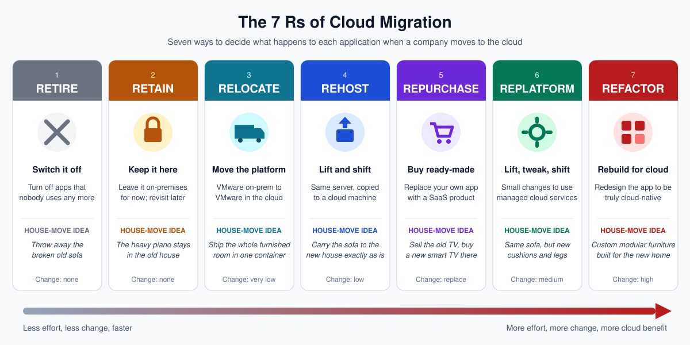
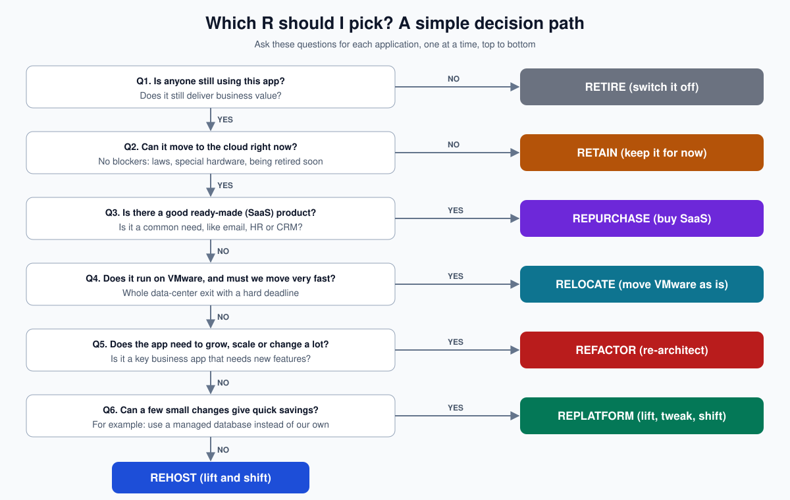
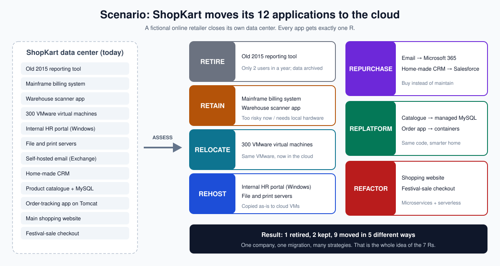

# Cloud Migration: The 7 Rs Explained

*A plain-language guide for everyone: business leaders, project managers, and engineers.*
*References: AWS Prescriptive Guidance, Microsoft Cloud Adoption Framework for Azure, and Google Cloud migration guides.*

---

## Contents

1. [What is cloud migration?](#1-what-is-cloud-migration)
2. [Why do we need the 7 Rs?](#2-why-do-we-need-the-7-rs)
3. [The 7 Rs at a glance](#3-the-7-rs-at-a-glance)
4. [Each R explained in detail](#4-each-r-explained-in-detail)
5. [Side-by-side comparison](#5-side-by-side-comparison)
6. [How to choose the right R](#6-how-to-choose-the-right-r)
7. [Full scenario: ShopKart's migration](#7-full-scenario-shopkarts-migration)
8. [Same idea, different names: AWS vs Azure vs GCP](#8-same-idea-different-names-aws-vs-azure-vs-gcp)
9. [Tools each cloud provides](#9-tools-each-cloud-provides)
10. [Common mistakes to avoid](#10-common-mistakes-to-avoid)
11. [Glossary](#11-glossary)
12. [References](#12-references)

---

## 1. What is cloud migration?

**Cloud migration** means moving a company's software, data and servers from its **own building** (an "on-premises data center") to a **cloud provider** such as AWS, Microsoft Azure or Google Cloud.

> **Think of it like this:** Today the company owns a house and fixes the plumbing, roof and electricity itself. Moving to the cloud is like moving into a well-managed apartment complex. The building owner (the cloud provider) handles the building; you just live there and pay rent for what you use.

**Why companies do it**

| Reason | What it means in simple words |
|---|---|
| Lower cost | Stop buying expensive servers every few years; pay only for what you use |
| Speed | Get a new server in minutes instead of waiting weeks for hardware |
| Scale | Handle a festival-sale traffic spike, then shrink back afterwards |
| Reliability | Data copied across many locations, so one failure doesn't stop the business |
| Focus | Staff spend time on the business, not on fixing hardware |

---

## 2. Why do we need the 7 Rs?

A typical company doesn't have one application. It has **dozens or hundreds**: a website, an email system, an HR portal, billing, reports, and more.

They are **not all the same**:

- Some are old and nobody uses them.
- Some are critical and must never go down.
- Some are simple to copy across; others need to be rebuilt.
- Some can simply be replaced by a product you can buy online.

So you can't use one method for everything. The **7 Rs** are seven standard choices. For **each application**, the team picks **one R**.

> **House-move analogy:** When you move house, you don't treat every item the same way. You throw some things away, leave some behind, pack some as they are, upgrade some, and buy some new. The 7 Rs are exactly that, for software.

AWS describes the 7 Rs as building on an earlier model of strategies that Gartner identified. Azure and Google Cloud use the same ideas with slightly different names (see [Section 8](#8-same-idea-different-names-aws-vs-azure-vs-gcp)).

---

## 3. The 7 Rs at a glance



| # | R | One-line meaning | House-move idea | Amount of change |
|---|---|---|---|---|
| 1 | **Retire** | Switch it off | Throw away the broken sofa | None |
| 2 | **Retain** | Keep it where it is, for now | The heavy piano stays behind | None |
| 3 | **Relocate** | Move the whole platform as is (e.g. VMware to VMware in the cloud) | Ship a fully furnished room in a container | Very low |
| 4 | **Rehost** | "Lift and shift": copy the server to the cloud unchanged | Carry the sofa over exactly as it is | Low |
| 5 | **Repurchase** | Replace with a ready-made product (SaaS) | Sell the old TV, buy a new smart TV | Replace |
| 6 | **Replatform** | "Lift, tweak and shift": small changes to use cloud services | Same sofa, new cushions and legs | Medium |
| 7 | **Refactor / Re-architect** | Redesign the application for the cloud | Custom modular furniture built for the new home | High |

**Simplest to most complex** (as AWS orders them):
`Retire → Retain → Relocate → Rehost → Repurchase → Replatform → Refactor`

---

## 4. Each R explained in detail

Each section follows the same layout: **What it is → Simple example → When to use it → Good and bad → Real-world example.**

---

### R1. Retire 🗑️ — "Switch it off"

**What it is:** Turn off applications that are no longer needed. Nothing is moved.

**Simple example:** A 2015 reporting tool that only two people opened last year. Its reports are now available in a newer system.

```
Before:   [ Old reporting tool ]  ── running, costing money
After:    [   switched off     ]  ── data archived, cost = 0
```

**When to use it**
- Few or no users
- Another system already does the same job
- Kept running only "just in case"

**Good:** Instant savings, less to migrate, less security risk.
**Watch out:** Archive the data and confirm with business owners before switching off.

> 💡 **Did you know?** Discovery in large migrations often finds a meaningful share of applications that can simply be retired. Every app you retire is one you don't need to migrate.

---

### R2. Retain 🔒 — "Keep it here for now"

**What it is:** Leave the application where it is today. Revisit it later.

**Simple example:** A mainframe billing system that is too risky to move this year, or a warehouse scanner app that must sit next to physical hardware in the warehouse.

```
Before:   [ Billing mainframe ]  in own data center
After:    [ Billing mainframe ]  still in own data center (reviewed again next year)
```

**When to use it**
- Laws or regulations require data to stay in a specific place
- Depends on special hardware
- Recently upgraded, or due to be retired in a year or two anyway
- Too risky; needs more planning first

**Good:** No risk now, no effort now.
**Watch out:** "Retain" should not become "forget". Set a review date.

---

### R3. Relocate 🚚 — "Move the whole platform as it is"

**What it is:** Move a large group of servers to the cloud **at the hypervisor level** without changing each one. The most common case: **VMware on-premises → VMware running in the cloud**. AWS describes this as moving infrastructure without buying new hardware, rewriting applications, or changing existing operations.

**Simple example:** A company with 300 VMware virtual machines must leave its data center in 3 months. Instead of converting each machine, they move the entire VMware environment to VMware in the cloud. The IT team keeps using the same VMware tools they know.

```
Before:   [ VMware in own data center ] ─┐
                                         │  vMotion / HCX (same VMware, new location)
After:    [ VMware in the cloud ] ◄──────┘
```

**Cloud options**

| Provider | Service |
|---|---|
| AWS | VMware Cloud on AWS |
| Azure | Azure VMware Solution |
| Google Cloud | Google Cloud VMware Engine |

AWS also uses "Relocate" for moving resources between AWS accounts, regions or VPCs, for example moving a database to another account.

**When to use it**
- Large VMware estate and a hard data-center exit date
- Team skills are in VMware; little time to retrain

**Good:** Fastest way to move many servers; almost no downtime; same tools.
**Watch out:** You still pay for VMware licensing and don't get cloud-native benefits yet. Many companies later move workloads out of VMware into native cloud services (rehost or replatform). This is exactly what a "VMC to AWS-native" project does.

---

### R4. Rehost 🏗️ — "Lift and shift"

**What it is:** Copy each server to a cloud virtual machine **with no changes** to the application.

**Simple example:** An internal HR portal running on a Windows server is copied as-is to an Amazon EC2 / Azure VM / Google Compute Engine machine. Users don't notice any difference, except it is no longer in the company's building.

```
Before:   [ Windows server: HR portal ]   own data center
              │  replicate disk, switch over
              ▼
After:    [ Cloud VM: HR portal ]          same OS, same app, same config
```

**When to use it**
- Need to move quickly and with low risk
- Application works fine; no immediate need to modernise
- Team is new to the cloud (good way to learn)

**Good:** Fast, low risk, predictable; large numbers of servers can be moved in "waves".
**Watch out:** Old problems move with you. If the app was slow on-premises, it will be slow in the cloud too. Costs may be higher than expected if servers aren't right-sized.

> 💡 **Tip:** A common pattern is **"rehost now, optimise later"**: move quickly to meet the deadline, then improve once you are in the cloud, where improving is easier.

---

### R5. Repurchase 🛒 — "Buy ready-made"

**What it is:** Stop running your own version of an application and switch to a **ready-made cloud product** (Software-as-a-Service, or SaaS). Azure calls this **Replace**; it is sometimes called "drop and shop".

**Simple examples**

| Today (self-run) | Repurchase to (SaaS) |
|---|---|
| Own email server (Exchange) | Microsoft 365 or Google Workspace |
| Home-made CRM | Salesforce, HubSpot or Zoho CRM |
| Own HR / payroll system | Workday, SAP SuccessFactors |
| Own ticketing system | ServiceNow, Jira Service Management |

```
Before:   [ Own email servers + storage + backups + patching ]
After:    [ Microsoft 365 ] ── vendor runs everything; you pay per user
```

**When to use it**
- The job is common (email, CRM, HR) and gives no special business advantage
- Maintaining your own version is expensive

**Good:** No servers to manage; new features arrive automatically.
**Watch out:** Data migration, staff training, licence costs, and less control over customisation.

---

### R6. Replatform 🔧 — "Lift, tweak and shift"

**What it is:** Move the application **with a few targeted changes** so it can use cloud-managed services, without rewriting the core code. Google Cloud calls this **"lift and optimize"**.

**Simple example:** The product catalogue uses a MySQL database the team manages themselves: patching, backups, failover. During migration, they move the data to a **managed database** (Amazon RDS / Azure Database for MySQL / Cloud SQL). The application code stays the same; only the connection settings change. Now backups and patching happen automatically.

```
Before:   [ App server ] ──► [ Self-managed MySQL on a VM ]
After:    [ App server ] ──► [ Managed MySQL: auto backup, patching, failover ]
                    ▲
            only the connection string changed
```

**Other common replatform moves**
- Java app on Tomcat → containers (Amazon ECS/EKS, Azure Kubernetes Service, Google GKE)
- Old OS version → current OS version
- Self-managed message queue → managed queue service

**When to use it**
- You want real cloud benefits without a full rewrite
- A clear "quick win" exists (the database is the usual one)

**Good:** Balance of speed and benefit; less operational work afterwards.
**Watch out:** Takes longer than rehost; needs testing after each change.

---

### R7. Refactor / Re-architect 🏛️ — "Rebuild for the cloud"

**What it is:** Redesign and rewrite the application to fully use cloud features: microservices, containers, serverless functions, auto-scaling and managed services. Google Cloud calls this **"move and improve"**; Azure splits it into **Refactor**, **Rearchitect** and **Rebuild**, depending on how deep the change is.

**Simple example:** The main shopping website is one big program (a "monolith"). During festival sales it crashes because the whole thing must scale together. The team breaks it into small independent services: search, cart, payment, and recommendations. Each service scales on its own. Checkout runs on serverless functions that grow automatically when 50,000 people buy at once, and shrink to near zero at night.

```
Before:   [   One big website: search + cart + payment + reviews   ]   (scales as one block)

After:    [ Search ]  [ Cart ]  [ Payment ]  [ Reviews ]
              │          │          │            │
           scales     scales    serverless    scales
         separately separately  auto-scale   separately
```

**When to use it**
- The app is central to the business and must scale or change quickly
- The current design blocks growth or new features
- Licence costs of the old platform are very high

**Good:** Best long-term performance, scaling and cost efficiency; faster feature releases.
**Watch out:** Most time, cost and skill required; highest project risk. AWS's large-migration guidance notes refactor is not ideal **during** a big migration, because it means modernising while moving. Often done as a second phase after rehost or replatform.

---

## 5. Side-by-side comparison

| R | Speed to move | Effort / cost to move | Risk | Long-term cloud benefit | Best for |
|---|---|---|---|---|---|
| Retire | ⚡⚡⚡⚡⚡ | 💲 | Very low | Savings only | Unused apps |
| Retain | — (not moved) | 💲 | Very low | None (yet) | Blocked or risky apps |
| Relocate | ⚡⚡⚡⚡⚡ | 💲💲 | Low | Low | Big VMware estates, deadlines |
| Rehost | ⚡⚡⚡⚡ | 💲💲 | Low | Low–Medium | Fast data-center exit |
| Repurchase | ⚡⚡⚡ | 💲💲💲 | Medium | Medium–High | Commodity apps (email, CRM) |
| Replatform | ⚡⚡⚡ | 💲💲💲 | Medium | Medium–High | Quick wins like managed databases |
| Refactor | ⚡ | 💲💲💲💲💲 | High | Highest | Core, growth-critical apps |

**The big trade-off in one sentence:** The more you change during the move, the longer it takes and the more it costs now, but the more value you get from the cloud later.

---

## 6. How to choose the right R

Follow the questions top to bottom for **each application**. Stop at the first "match".



**The same path as a checklist:**

1. **Is anyone still using it?** No → **Retire**
2. **Can it move right now?** (no legal, hardware or timing blockers) No → **Retain**
3. **Is there a good SaaS product for this job?** Yes → **Repurchase**
4. **Is it on VMware and must we move very fast?** Yes → **Relocate**
5. **Does it need to scale or change a lot, and is it business-critical?** Yes → **Refactor**
6. **Can a few small changes give quick savings?** Yes → **Replatform**
7. **Otherwise** → **Rehost** (lift and shift; optimise later)

**Who decides?** Not the cloud team alone. Each decision should involve:

| Person | What they bring |
|---|---|
| Business / app owner | How important it is, who uses it, what downtime is acceptable |
| Architect / cloud engineer | Technical fit, dependencies, effort |
| Security & compliance | Data rules (where data may live) |
| Finance | Cost today vs cost in the cloud |

> 💡 **Tip:** Use a **discovery tool** first (see [Section 9](#9-tools-each-cloud-provides)). It scans servers and shows what talks to what, so you don't move an app and break another that depends on it.

---

## 7. Full scenario: ShopKart's migration

**The company:** *ShopKart* is a fictional online retailer with 12 applications in its own data center. The data-center lease ends in 9 months. Leadership wants to move to the cloud, cut costs, and stop the website crashing during festival sales.



### Step 1 — Discover
The team runs a discovery tool for 4 weeks. It lists every server, how busy it is, and which applications talk to each other.

### Step 2 — Decide one R per app

| Application | Chosen R | Why | Target |
|---|---|---|---|
| Old 2015 reporting tool | **Retire** | 2 users in a year; replaced by newer dashboards | Archive data, switch off |
| Mainframe billing | **Retain** | Too risky this year; planned for phase 2 | Stays on-premises |
| Warehouse scanner app | **Retain** | Needs local hardware in the warehouse | Stays on-site |
| 300 VMware VMs (misc. internal apps) | **Relocate** | Hard 9-month deadline; team knows VMware | VMware in the cloud |
| HR portal (Windows) | **Rehost** | Works fine; just needs to leave the building | Cloud VM |
| File and print servers | **Rehost** | Simple, low risk | Cloud VM |
| Email (Exchange) | **Repurchase** | Email is a commodity | Microsoft 365 |
| Home-made CRM | **Repurchase** | Expensive to maintain; SaaS is better | Salesforce |
| Catalogue database (MySQL) | **Replatform** | Quick win: no more manual backups and patching | Managed MySQL |
| Order-tracking app (Tomcat) | **Replatform** | Package in containers for easier deployment | Managed Kubernetes |
| Main shopping website | **Refactor** | Crashes on sale days; must scale | Microservices |
| Festival-sale checkout | **Refactor** | Needs to handle huge spikes | Serverless + auto-scaling |

### Step 3 — Move in waves
Never move everything on one weekend. Group apps into **waves**, easiest first:

```
Wave 0  (Month 1)    Retire the reporting tool. Build the cloud "landing zone": accounts, network, security.
Wave 1  (Month 2)    Rehost file servers + HR portal       → team learns, low risk
Wave 2  (Month 3–5)  Relocate the 300 VMware VMs           → biggest chunk out of the data center
Wave 3  (Month 4–6)  Repurchase email + CRM                → run alongside users' training
Wave 4  (Month 5–8)  Replatform catalogue DB + order app
Wave 5  (Month 6–12) Refactor website + checkout           → can continue after data-center exit
Phase 2 (Next year)  Review retained apps; move VMware workloads to native cloud services
```

### Step 4 — Result
- Data center closed on time.
- 1 app retired, 2 retained, **9 moved using 5 different strategies**.
- Festival sale: the refactored checkout scales automatically; no crash.
- Email and CRM are no longer the IT team's problem.

> **Key lesson:** One company, one migration, **many** strategies. Choosing the right R for each app is what makes a migration succeed.

---

## 8. Same idea, different names: AWS vs Azure vs GCP

All three providers describe the same ideas. Names and grouping differ slightly.

| Idea | AWS (7 Rs) | Microsoft Azure (CAF) | Google Cloud |
|---|---|---|---|
| Switch it off | **Retire** | **Retire** | (assessed in planning; decommission) |
| Keep it where it is | **Retain** | **Retain** | (stays out of scope) |
| Move whole VMware platform | **Relocate** | (Rehost using Azure VMware Solution) | (Rehost using Google Cloud VMware Engine) |
| Copy as-is | **Rehost** ("lift and shift") | **Rehost** (like-for-like) | **Rehost** ("lift and shift") |
| Small changes, managed services | **Replatform** ("lift, tinker and shift") | **Replatform** | **Replatform** ("lift and optimize") |
| Buy SaaS instead | **Repurchase** | **Replace** | **Repurchase** |
| Change code for cloud | **Refactor / Re-architect** | **Refactor** (code) and **Rearchitect** (design) | **Refactor** ("move and improve") |
| Write it again from scratch | (part of Refactor) | **Rebuild** | **Rebuild** ("remove and replace", or "rip and replace") |

**In short**
- **AWS** has 7 Rs and is the only one with a separate **Relocate**.
- **Azure** splits deep changes into **Refactor, Rearchitect and Rebuild**, and calls repurchase **Replace**.
- **Google Cloud** uses friendly nicknames: *lift and shift*, *lift and optimize*, *move and improve*, *remove and replace*.

---

## 9. Tools each cloud provides

| Purpose | AWS | Azure | Google Cloud |
|---|---|---|---|
| Discover and assess servers | AWS Application Discovery Service, Migration Evaluator, AWS Transform | Azure Migrate (Discovery & Assessment) | Migration Center |
| Track the whole migration | AWS Migration Hub | Azure Migrate hub | Migration Center |
| Rehost servers | AWS Application Migration Service (MGN) | Azure Migrate: Server Migration | Migrate to Virtual Machines |
| Relocate VMware | VMware Cloud on AWS (with VMware HCX) | Azure VMware Solution | Google Cloud VMware Engine |
| Move databases | AWS Database Migration Service (DMS) | Azure Database Migration Service | Database Migration Service |
| Containerise apps (replatform) | AWS App2Container | Azure Migrate app containerisation | Migrate to Containers |
| Move large data offline | AWS Snowball | Azure Data Box | Transfer Appliance |

*Third-party discovery tools (for example Matilda Cloud, Cloudamize, Device42) are also widely used.*

*Service names change over time; check each provider's current documentation before planning.*

---

## 10. Common mistakes to avoid

| ❌ Mistake | ✅ Do this instead |
|---|---|
| Using one R for every application | Decide per application |
| Moving without knowing dependencies | Run a discovery tool first; map who talks to whom |
| Refactoring everything during a deadline-driven move | Rehost or relocate first; refactor in a later phase |
| Forgetting to switch off the old servers | Plan decommission as part of every wave |
| Lift-and-shift without right-sizing | Size cloud machines on real usage, not old hardware specs |
| "Retain" with no review date | Put a review date on every retained app |
| Leaving business owners out | Get sign-off on each R from the app owner |
| Skipping the landing zone | Set up accounts, network, security and billing before Wave 1 |

---

## 11. Glossary

| Term | Plain meaning |
|---|---|
| **On-premises (on-prem)** | Servers in the company's own building or data center |
| **Cloud provider** | Company renting computing power over the internet (AWS, Azure, Google Cloud) |
| **Workload / application** | A piece of software the business runs, plus its servers and data |
| **Virtual machine (VM)** | A software "computer" running on a real physical server |
| **Hypervisor / VMware** | Software that runs many VMs on one physical machine; VMware is the most common |
| **SaaS** | Software-as-a-Service: ready-made software you use through a browser and pay for monthly |
| **Managed service** | A cloud service where the provider handles maintenance (backups, patching) |
| **Container** | A lightweight package that holds an app and everything it needs to run |
| **Microservices** | Splitting one big app into small independent parts |
| **Serverless** | Running code without managing any servers; it scales automatically |
| **Monolith** | One big application where all features are bundled together |
| **Landing zone** | The prepared, secure cloud foundation (accounts, network, rules) before moving apps |
| **Wave** | A group of applications moved together in one phase |
| **Cutover** | The moment users switch from the old system to the new one |
| **Discovery** | Scanning the current environment to list servers, usage and dependencies |

---

## 12. References

- **AWS:** Prescriptive Guidance — *About the migration strategies* (Large migration guide):
  https://docs.aws.amazon.com/prescriptive-guidance/latest/large-migration-guide/migration-strategies.html
- **AWS:** Prescriptive Guidance — *Paths to the cloud*:
  https://docs.aws.amazon.com/prescriptive-guidance/latest/migration-microsoft-workloads-aws/cloud-paths.html
- **Microsoft Azure:** Cloud Adoption Framework — *Adopt* and migration strategy guidance:
  https://learn.microsoft.com/en-us/azure/cloud-adoption-framework/adopt
- **Microsoft Azure:** *Migrate to Azure*:
  https://learn.microsoft.com/en-us/azure/migration/migrate-to-azure
- **Google Cloud:** *Migrate to Google Cloud: Get started* (types of migrations):
  https://cloud.google.com/architecture/migration-to-gcp-getting-started

---

*Images in this guide are original illustrations in the `images/` folder. Keep that folder next to this file so the pictures display.*
