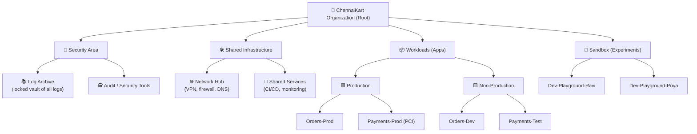
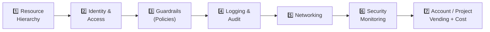
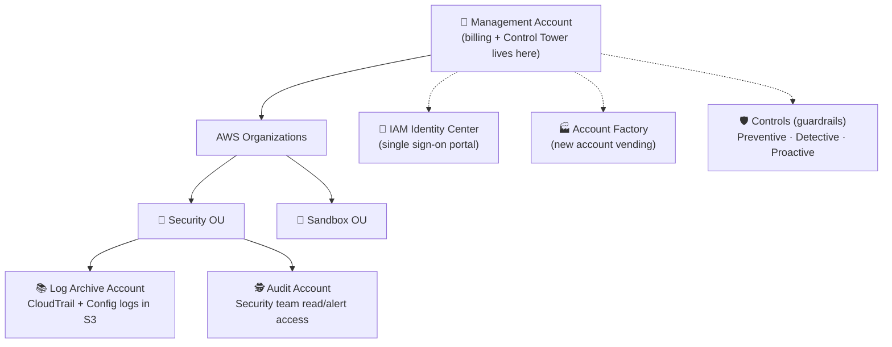
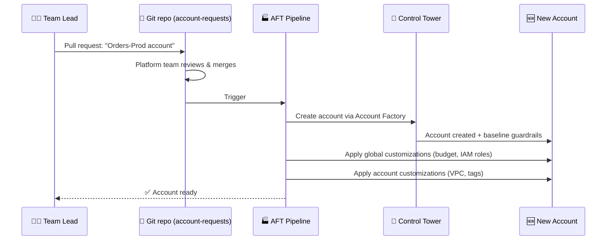
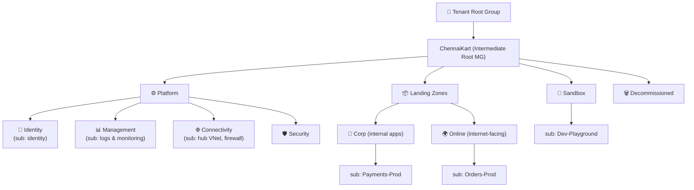
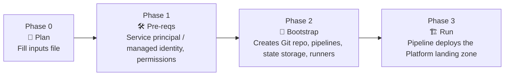
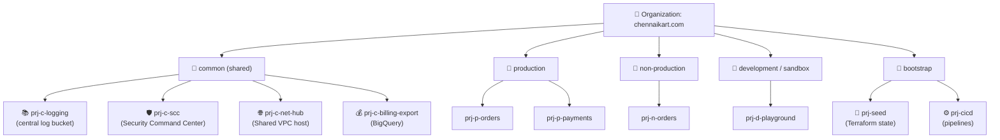
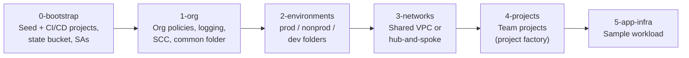
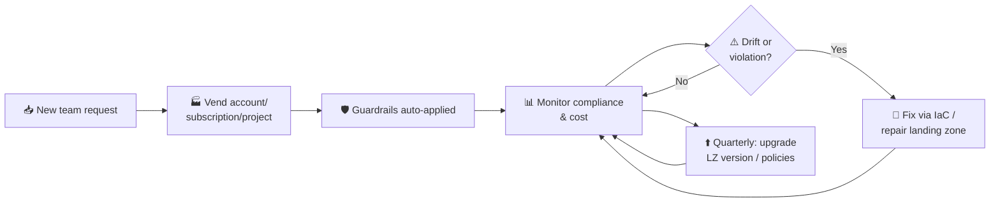

# ☁️ Landing Zones & Control Tower — Complete Guide

### AWS · Azure · Google Cloud — Step-by-Step, Explained for Everyone

> **Who is this for?**
> Managers, students, auditors, and engineers. Each section **starts in plain English** and **ends with the technical steps and code**. If you are non-technical, read the 🟢 parts and look at the diagrams. Engineers can go straight to the 🔧 parts.

> **Viewing tip:** The diagrams use **Mermaid**. They render automatically on GitHub, GitLab, VS Code (with the Markdown Preview Mermaid extension), Notion, and Obsidian. Each diagram also has a plain-text version so it can be read anywhere.

---

## 📑 Table of Contents

1. [The Big Idea (non-technical)](#1--the-big-idea-non-technical)
2. [Our Story: The ChennaiKart Scenario](#2--our-story-the-chennaikart-scenario)
3. [The 7 Building Blocks of Every Landing Zone](#3--the-7-building-blocks-of-every-landing-zone)
4. [Same Idea, Different Names (AWS vs Azure vs GCP)](#4--same-idea-different-names)
5. [AWS — Control Tower Step by Step](#5--aws--control-tower-step-by-step)
6. [Azure — Azure Landing Zone Step by Step](#6--azure--azure-landing-zone-step-by-step)
7. [Google Cloud — Landing Zone Step by Step](#7--google-cloud--landing-zone-step-by-step)
8. [Day-2 Operations: Life After Setup](#8--day-2-operations-life-after-setup)
9. [Common Mistakes & How to Avoid Them](#9--common-mistakes--how-to-avoid-them)
10. [Readiness Checklist](#10--readiness-checklist)
11. [Glossary](#11--glossary)
12. [Official References](#12--official-references)

---

## 1. 🟢 The Big Idea (non-technical)

### What is a Landing Zone?

Imagine a builder buys a large piece of empty land to build a **gated township** with 500 homes.

Before a single house is built, they need:

| Township | Cloud Landing Zone |
|---|---|
| 🚧 Compound wall and gate with security guards | **Identity & access** — who can enter, with what badge |
| 🛣️ Roads, water pipes, electricity lines | **Networking** — how systems connect to each other and the internet |
| 📜 Township rules ("no commercial shops in residential blocks") | **Policies / guardrails** — rules that are automatically enforced |
| 📹 CCTV cameras and visitor logbook | **Logging & monitoring** — record of everything that happens |
| 🏘️ Separate blocks: Villas, Apartments, Clubhouse | **Accounts / subscriptions / projects** — separate areas for separate teams |
| 🏢 Township management office | **Control Tower / management tooling** |
| 💡 Separate electricity meter per house | **Cost tracking per team** |

> **A Landing Zone is the "ready-to-move-in township" for your company's cloud.**
> Teams can start building their apps immediately, and safety, rules, and billing are already handled.

### What is Control Tower?

**AWS Control Tower** is Amazon's **"township management office in a box."** You click a few buttons (or run a script) and it builds the township for you: the security office, the CCTV room, the rule book, and a form for "give me a new house."

Azure and Google Cloud do **not** use the name "Control Tower," but they offer the **same idea** through their own tools (covered in sections 6 and 7).

### Why bother? Before vs After

```
❌ WITHOUT a Landing Zone                     ✅ WITH a Landing Zone
──────────────────────────────                ──────────────────────────────
Every team creates cloud accounts             New accounts come from one "factory"
  their own way                                 with security pre-installed
Passwords and admin access shared             Single sign-on, least privilege
No idea who deleted the database             Every action logged in a locked vault
Someone opens a server to the internet        Guardrail blocks it automatically
Bill arrives: ₹40 lakh, nobody knows why      Cost tagged per team and per project
Audit takes 3 months of panic                 Audit evidence is already collected
```

---

## 2. 🟢 Our Story: The ChennaiKart Scenario

We will follow one fictional company through the whole guide.

> **ChennaiKart** is an online grocery start-up. It started with **1 cloud account** and 5 developers.
> Two years later it has **60 engineers, 4 product teams, a payments system that must follow RBI/PCI-DSS rules**, and customers in India and the Middle East.

### What went wrong (the "before" picture)

- 😱 A developer tested code in the **same account as production** and accidentally deleted customer orders.
- 🔓 A storage bucket with invoices was left **public**.
- 💸 Someone launched 20 powerful GPU servers "for testing" and forgot them — **₹6 lakh bill**.
- 📋 The auditor asked "who had admin access in March?" Nobody could answer.

### What ChennaiKart decided

The CTO said: *"We need a proper foundation. Every team gets its own separated space, rules are enforced automatically, and all logs go to one locked place."*

That foundation is the **Landing Zone**. Here is the target design (it looks nearly the same on every cloud):



**Plain-text version:**

```
ChennaiKart Organization
├── Security
│   ├── Log Archive        ← all logs, nobody can delete
│   └── Audit              ← security team's tools
├── Infrastructure
│   ├── Network Hub        ← internet/VPN entry point
│   └── Shared Services    ← CI/CD, monitoring
├── Workloads
│   ├── Production
│   │   ├── Orders-Prod
│   │   └── Payments-Prod  ← extra-strict PCI rules
│   └── Non-Production
│       ├── Orders-Dev
│       └── Payments-Test
└── Sandbox
    ├── Dev-Playground-Ravi   ← budget-capped, auto-cleaned
    └── Dev-Playground-Priya
```

**Rules ChennaiKart wants enforced everywhere ("guardrails"):**

| # | Rule | Why (plain English) |
|---|---|---|
| R1 | Only use India (Mumbai/Hyderabad) and UAE regions | Data must stay in approved countries |
| R2 | No public storage buckets | Prevents the invoice leak |
| R3 | Logs cannot be switched off or deleted | Auditor can always see "who did what" |
| R4 | No one logs in with the root/owner password | Use named, individual logins only |
| R5 | All disks and databases encrypted | Stolen disk = useless data |
| R6 | Sandbox accounts have a monthly budget alert | No more surprise GPU bills |
| R7 | Production needs MFA (two-factor login) | Stolen password alone is not enough |

We will now build **this exact design** on AWS, Azure, and GCP.

---

## 3. 🟢 The 7 Building Blocks of Every Landing Zone



| # | Block | Plain English | Example at ChennaiKart |
|---|---|---|---|
| 1 | **Resource hierarchy** | Folders to organize everything | Prod / Non-Prod / Sandbox |
| 2 | **Identity & access** | Who can log in and what they can do | Ravi = developer in Dev only |
| 3 | **Guardrails** | Automatic rules that block or flag bad things | "No public buckets" |
| 4 | **Logging & audit** | A CCTV recording of every action | Central, tamper-proof log store |
| 5 | **Networking** | Roads between systems and to the outside | Hub network with firewall |
| 6 | **Security monitoring** | Alarm system | Threat detection, compliance score |
| 7 | **Vending + cost** | A form that creates a new, ready-made account | "New team? Here's your account in 30 min" |

> 💡 **Key insight:** Guardrails come in two types:
> - **Preventive** 🛑 — *stops* the bad action ("you are not allowed to do that").
> - **Detective** 🔎 — *allows* it but *raises an alert* ("someone did something risky").
> - (AWS also has **Proactive** ✋ — checks infrastructure code *before* it is deployed.)

---

## 4. 🟢 Same Idea, Different Names

| Concept | 🟧 AWS | 🟦 Azure | 🟩 Google Cloud |
|---|---|---|---|
| Top level | Organization (Root) | Tenant Root Management Group | Organization node |
| Folder / grouping | **Organizational Unit (OU)** | **Management Group** | **Folder** |
| Unit that holds resources & bill | **Account** | **Subscription** (+ Resource Groups) | **Project** |
| Landing zone service / tool | **AWS Control Tower** (+ AFT, LZA) | **Azure Landing Zone Accelerator** (portal or IaC with AVM) | **Google Cloud Setup** (guided) / **Fabric FAST** / **terraform-example-foundation** |
| Preventive rules | SCPs, RCPs, declarative policies | Azure Policy (*Deny*) | Organization Policies |
| Detective rules | AWS Config rules | Azure Policy (*Audit*), Defender for Cloud | Security Command Center |
| Single sign-on | IAM Identity Center | Microsoft Entra ID | Cloud Identity / Google Workspace |
| Central logs | CloudTrail + Config → Log Archive account | Log Analytics workspace | Log sinks → central log bucket/project |
| Hub network | Transit Gateway | Hub VNet / Virtual WAN | Shared VPC / Hub-and-spoke VPC |
| "Give me a new account" | Account Factory / AFT | Subscription vending | Project factory |
| Cost of the tool itself | Free (you pay for Config, CloudTrail, etc.) | Free (you pay for deployed resources) | Free (you pay for deployed resources) |

---

## 5. 🟧 AWS — Control Tower Step by Step

### 5.1 🟢 What AWS Control Tower builds for you

When you click **"Set up landing zone"**, Control Tower automatically creates:



| Created item | Plain-English role |
|---|---|
| **Management account** | The "head office." Pays the bill. **Never run apps here.** |
| **Log Archive account** | The locked vault that stores every log from every account |
| **Audit account** | Where the security team works. It can look into all accounts |
| **Security OU / Sandbox OU** | Starter folders |
| **IAM Identity Center** | One login page for all accounts |
| **Controls** | Ready-made guardrails, some mandatory and some optional |
| **Account Factory** | A form to create new, pre-secured accounts |

> 🆕 **What's new — Landing Zone version 4.0 (released Nov 2025):**
> Earlier versions were "all or nothing." In **v4.0, the AWS Config, CloudTrail, SecurityRoles and AWS Backup integrations can each be turned on or off**, Control Tower **no longer forces a "Security" OU** (you design your own structure), and the manifest becomes optional, so a **"controls-only"** setup on an existing AWS Organization is possible. Drift alerts move from SNS to **Amazon EventBridge** when the full baseline is not enabled.
> ⚠️ Upgrading from 3.x to 4.0 **cannot be rolled back.** Test it in a non-production organization first.

### 5.2 🔧 Prerequisites

| ✅ | Requirement |
|---|---|
| ☐ | A **dedicated, new** AWS account to be the management account (best practice) |
| ☐ | Two **unused email addresses** for Log Archive and Audit accounts (e.g. `aws-logs@chennaikart.com`, `aws-audit@chennaikart.com`). Use group mailboxes, not personal ones |
| ☐ | Decide your **home Region** (cannot be changed later!). Example: `ap-south-1` (Mumbai) |
| ☐ | Decide **governed Regions** (e.g. `ap-south-1`, `ap-south-2`, `me-central-1`) |
| ☐ | Sign in as a user with **AdministratorAccess** (not the root user) |
| ☐ | If AWS Organizations already exists, check existing SCPs, Config recorders and CloudTrail trails, which may conflict |
| ☐ | Optional: a customer-managed **KMS key** to encrypt logs |

### 5.3 🔧 Option A — Set up using the Console (click-by-click)

```
AWS Console → Search "Control Tower" → Set up landing zone
```

| Step | Screen | What to choose (ChennaiKart example) | Plain-English meaning |
|---|---|---|---|
| 1 | **Review pricing & select Regions** | Home: `Asia Pacific (Mumbai)`. Governed: Mumbai, Hyderabad, UAE. Enable **Region deny** | "We only build houses in these cities. All other cities are blocked." (Rule R1) |
| 2 | **Configure OUs** | Keep `Security` and `Sandbox` (v4.0 lets you rename or skip) | Starter folders |
| 3 | **Shared accounts** | Create new: Log Archive (`aws-logs@…`), Audit (`aws-audit@…`) | The CCTV vault and the security office |
| 4 | **Additional configuration** | IAM Identity Center: **On**. CloudTrail: **On**. Log retention: 1 year (logs) / 10 years (access logs). KMS encryption: **On** | Single login + logs kept for 1 year, encrypted |
| 5 | **Service integrations (v4.0)** | AWS Config: **On**. Backup: optional | Turn on the "compliance camera" |
| 6 | **Review & Set up** | Tick the acknowledgements → **Set up landing zone** | ⏳ Takes about **30–60 minutes** |

When finished, the dashboard shows **"Your landing zone is ready."**

**Step 7 — Build the ChennaiKart OU structure**

```
Control Tower → Organization → Create resources → Create organizational unit
```

Create: `Infrastructure`, `Workloads`, `Workloads/Production`, `Workloads/NonProduction` (nested OUs are supported), plus `Sandbox`.

**Step 8 — Turn on extra guardrails (controls)**

```
Control Tower → Control library → search control → Enable control → pick OU
```

| ChennaiKart Rule | Control to enable (examples) | Behavior | OU |
|---|---|---|---|
| R2 No public buckets | *Disallow public read access to S3 buckets* | Detective | All |
| R3 Logs protected | *Disallow changes to CloudTrail* (mandatory, already on) | Preventive | All |
| R4 No root login | *Disallow actions as a root user* | Preventive | Workloads |
| R5 Encryption | *Detect whether encryption is enabled for EBS volumes* | Detective | Workloads |
| R7 MFA | *Detect whether MFA for the root user is enabled* | Detective | All |
| PCI extra | Enable a **compliance framework** pack (e.g. PCI DSS-aligned controls) via Control Catalog | Mixed | Payments OU |

**Step 9 — Create accounts with Account Factory**

```
Control Tower → Account factory → Create account
```

| Field | Example |
|---|---|
| Account email | `aws-orders-prod@chennaikart.com` |
| Display name | `Orders-Prod` |
| IAM Identity Center user | `cloud-admin@chennaikart.com` |
| Organizational unit | `Workloads/Production` |

In about 20–30 minutes you get a new account with logging, guardrails and SSO already applied.

**Step 10 — Set up people access (IAM Identity Center)**

```
IAM Identity Center → Groups → Create "Developers", "PlatformAdmins", "Auditors"
                    → AWS accounts → assign group + permission set to account
```

| Group | Permission set | Accounts |
|---|---|---|
| PlatformAdmins | AdministratorAccess | All |
| Developers | PowerUserAccess | Orders-Dev, Payments-Test, Sandbox |
| Developers | ReadOnlyAccess | Orders-Prod |
| Auditors | SecurityAudit / ReadOnlyAccess | All |

### 5.4 🔧 Option B — Set up using the AWS CLI / API

**1. Create the required IAM roles** (needed only for API-based setup):
`AWSControlTowerAdmin`, `AWSControlTowerCloudTrailRole`, `AWSControlTowerStackSetRole`, `AWSControlTowerConfigAggregatorRoleForOrganizations`. AWS documents the exact trust policies in *"Launch your landing zone using the APIs."*

**2. Create Log Archive and Audit accounts in AWS Organizations:**

```bash
aws organizations create-account \
  --email aws-logs@chennaikart.com \
  --account-name "Log Archive"

aws organizations create-account \
  --email aws-audit@chennaikart.com \
  --account-name "Audit"

# Check status
aws organizations list-create-account-status --states SUCCEEDED
```

**3. Write the manifest file** `manifest.json`

*Classic format (landing zone v3.3):*

```json
{
  "governedRegions": ["ap-south-1", "ap-south-2", "me-central-1"],
  "organizationStructure": {
    "security": { "name": "Security" },
    "sandbox":  { "name": "Sandbox" }
  },
  "centralizedLogging": {
    "accountId": "111111111111",
    "configurations": {
      "loggingBucket":       { "retentionDays": 365 },
      "accessLoggingBucket": { "retentionDays": 3650 },
      "kmsKeyArn": "arn:aws:kms:ap-south-1:000000000000:key/REPLACE-ME"
    },
    "enabled": true
  },
  "securityRoles":    { "accountId": "222222222222" },
  "accessManagement": { "enabled": true }
}
```

*Landing zone v4.0* splits AWS Config into its own block and makes most sections optional. Illustrative shape (check field names against the current *CreateLandingZone* docs before use):

```json
{
  "governedRegions": ["ap-south-1", "ap-south-2", "me-central-1"],
  "centralizedLogging": {
    "enabled": true,
    "accountId": "111111111111",
    "configurations": { "loggingBucket": { "retentionDays": 365 } }
  },
  "config": {
    "enabled": true,
    "accountId": "222222222222",
    "configurations": { "loggingBucket": { "retentionDays": 365 } }
  },
  "securityRoles":    { "enabled": true, "accountId": "222222222222" },
  "accessManagement": { "enabled": true }
}
```

**4. Launch and track:**

```bash
aws controltower create-landing-zone \
  --landing-zone-version 4.0 \
  --manifest file://manifest.json

# Returns an operationIdentifier, use it to check progress
aws controltower get-landing-zone-operation \
  --operation-identifier <OPERATION_ID>
```

**5. Enable a control on an OU via CLI:**

```bash
# Find the OU ARN
aws organizations list-organizational-units-for-parent --parent-id r-xxxx

# Enable "disallow actions as root user" on Workloads OU
aws controltower enable-control \
  --control-identifier arn:aws:controltower:ap-south-1::control/AWS-GR_RESTRICT_ROOT_USER \
  --target-identifier  arn:aws:organizations::000000000000:ou/o-abc123/ou-wxyz-workload1

# List enabled controls on that OU
aws controltower list-enabled-controls \
  --target-identifier arn:aws:organizations::000000000000:ou/o-abc123/ou-wxyz-workload1
```

### 5.5 🔧 Option C — Terraform (Infrastructure as Code)

```hcl
# providers.tf
terraform {
  required_providers {
    aws = { source = "hashicorp/aws", version = "~> 6.0" }
  }
}
provider "aws" {
  region = "ap-south-1"   # must be your Control Tower home Region
}

# landing_zone.tf
resource "aws_controltower_landing_zone" "this" {
  manifest_json = file("${path.module}/manifest.json")
  version       = "3.3"   # or "4.0" with a v4-format manifest
}

# ous.tf
data "aws_organizations_organization" "org" {}

resource "aws_organizations_organizational_unit" "workloads" {
  name      = "Workloads"
  parent_id = data.aws_organizations_organization.org.roots[0].id
}

resource "aws_organizations_organizational_unit" "prod" {
  name      = "Production"
  parent_id = aws_organizations_organizational_unit.workloads.id
}

# controls.tf — enable guardrails on the Production OU
locals {
  prod_controls = [
    "AWS-GR_RESTRICT_ROOT_USER",            # R4 no root actions
    "AWS-GR_S3_BUCKET_PUBLIC_READ_PROHIBITED", # R2 no public buckets
    "AWS-GR_ENCRYPTED_VOLUMES",             # R5 encrypted EBS
  ]
}

resource "aws_controltower_control" "prod" {
  for_each           = toset(local.prod_controls)
  control_identifier = "arn:aws:controltower:ap-south-1::control/${each.value}"
  target_identifier  = aws_organizations_organizational_unit.prod.arn

  depends_on = [aws_controltower_landing_zone.this]
}
```

> ⚠️ An OU must be **registered** with Control Tower before controls apply to it. Register it from the console (*Organization → OU → Register*) or with the `enable-baseline` API.

### 5.6 🔧 Account Factory for Terraform (AFT): accounts as Git pull requests

**Plain English:** Instead of filling a form, a team opens a **pull request** saying "I need an account." When it is approved, the pipeline builds the account and applies your custom settings (VPC, budgets, roles).



**Deploy AFT (one time, from the management account):**

```hcl
module "aft" {
  source  = "aws-ia/control_tower_account_factory/aws"

  ct_management_account_id    = "000000000000"
  log_archive_account_id      = "111111111111"
  audit_account_id            = "222222222222"
  aft_management_account_id   = "333333333333"  # dedicated AFT account
  ct_home_region              = "ap-south-1"
  tf_backend_secondary_region = "ap-south-2"

  vcs_provider                                  = "github"
  account_request_repo_name                     = "chennaikart/aft-account-request"
  global_customizations_repo_name               = "chennaikart/aft-global-customizations"
  account_customizations_repo_name              = "chennaikart/aft-account-customizations"
  account_provisioning_customizations_repo_name = "chennaikart/aft-account-provisioning-customizations"
}
```

**Request an account (file in the `aft-account-request` repo):**

```hcl
module "orders_prod" {
  source = "./modules/aft-account-request"

  control_tower_parameters = {
    AccountEmail              = "aws-orders-prod@chennaikart.com"
    AccountName               = "Orders-Prod"
    ManagedOrganizationalUnit = "Production (ou-wxyz-prod1234)"
    SSOUserEmail              = "cloud-admin@chennaikart.com"
    SSOUserFirstName          = "Cloud"
    SSOUserLastName           = "Admin"
  }

  account_tags = {
    team        = "orders"
    environment = "prod"
    cost-center = "CC-1001"
  }

  change_management_parameters = {
    change_requested_by = "Orders Team"
    change_reason       = "New production account for Orders service"
  }

  account_customizations_name = "prod-baseline"   # folder in customizations repo
}
```

### 5.7 🔧 Add Rule R6: budget alert for every Sandbox account

Put this in `aft-account-customizations/sandbox/terraform/budget.tf`:

```hcl
resource "aws_budgets_budget" "sandbox_monthly" {
  name         = "sandbox-monthly-cap"
  budget_type  = "COST"
  limit_amount = "100"
  limit_unit   = "USD"
  time_unit    = "MONTHLY"

  notification {
    comparison_operator        = "GREATER_THAN"
    threshold                  = 80
    threshold_type             = "PERCENTAGE"
    notification_type          = "ACTUAL"
    subscriber_email_addresses = ["finops@chennaikart.com"]
  }
}
```

### 5.8 🔧 Example custom SCP: Payments OU may not disable GuardDuty

```json
{
  "Version": "2012-10-17",
  "Statement": [
    {
      "Sid": "ProtectGuardDuty",
      "Effect": "Deny",
      "Action": [
        "guardduty:DeleteDetector",
        "guardduty:DisassociateFromMasterAccount",
        "guardduty:UpdateDetector"
      ],
      "Resource": "*",
      "Condition": {
        "ArnNotLike": {
          "aws:PrincipalArn": "arn:aws:iam::*:role/AWSControlTowerExecution"
        }
      }
    }
  ]
}
```

```bash
aws organizations create-policy --name protect-guardduty \
  --type SERVICE_CONTROL_POLICY --content file://scp.json \
  --description "Payments: cannot disable GuardDuty"
aws organizations attach-policy --policy-id p-xxxx --target-id ou-wxyz-payments
```

> 💡 **When Control Tower is not enough:** very large or regulated organizations often add the **Landing Zone Accelerator on AWS (LZA)**, which sits on top of Control Tower and is configured with YAML files (networking, security services, compliance frameworks).

---

## 6. 🟦 Azure — Azure Landing Zone Step by Step

### 6.1 🟢 How Azure does it

Azure has no button named "Control Tower." Instead, Microsoft provides the **Azure Landing Zone (ALZ)** reference architecture, part of the *Cloud Adoption Framework*, plus **accelerators** that deploy it for you:

| Option | Best for | How |
|---|---|---|
| **Portal accelerator** | Teams new to Infrastructure as Code, or a quick proof of concept | Guided wizard in the Azure portal |
| **IaC accelerator** ⭐ *(Microsoft recommended)* | Production; teams using Git | Bicep **or** Terraform, built on **Azure Verified Modules (AVM)**, with a ready CI/CD pipeline in GitHub or Azure DevOps |

> 🆕 **What's new (2026):** Both Terraform and Bicep landing zones now use **Azure Verified Modules**. The old `caf-enterprise-scale` Terraform module was archived on **1 Aug 2026**, and "classic" ALZ-Bicep was removed from the accelerator in **Feb 2026**. New projects should use AVM.

### 6.2 🟢 What the Azure Landing Zone looks like



**Plain-text version:**

```
Tenant Root Group
└── ChennaiKart                      ← company-wide policies here
    ├── Platform
    │   ├── Identity                 ← domain controllers / identity services
    │   ├── Management               ← Log Analytics, Automation
    │   ├── Connectivity             ← hub VNet, Azure Firewall, VPN, DNS
    │   └── Security
    ├── Landing Zones
    │   ├── Corp                     ← private apps (Payments-Prod)
    │   └── Online                   ← public apps (Orders-Prod)
    ├── Sandbox                      ← experiments, no link to corp network
    └── Decommissioned               ← subscriptions being retired
```

> **"Platform landing zone" vs "Application landing zone":**
> - **Platform** = the shared township services (roads, security office) managed by the central cloud team.
> - **Application** = each team's house (a subscription), placed under *Corp* or *Online*.

### 6.3 🔧 Prerequisites

| ✅ | Requirement |
|---|---|
| ☐ | Microsoft Entra ID tenant with **Global Administrator** who can elevate to **User Access Administrator** at root (`/`) scope, one-time |
| ☐ | **3–4 subscriptions** for Platform: Management, Connectivity, Identity (Security optional). They can be combined for small setups |
| ☐ | Decide a **management group prefix** (e.g. `ck`) and a **primary region** (e.g. `centralindia`) + secondary (`southindia`) |
| ☐ | Network IP plan (e.g. hub `10.0.0.0/16`, spokes `10.1.0.0/16`, `10.2.0.0/16`…), with no overlap with office/on-prem ranges |
| ☐ | For IaC: GitHub or Azure DevOps org, PowerShell 7+, Azure CLI, Terraform (or Bicep) |

### 6.4 🔧 Option A — Portal accelerator (click-by-click)

Search **"Azure landing zone accelerator"** in the Microsoft Learn docs → click **Deploy to Azure** (opens the portal wizard).

| Step | Tab | ChennaiKart choice | Plain-English meaning |
|---|---|---|---|
| 1 | **Deployment location** | Region `Central India`, MG prefix `ck` | Name and location of the township |
| 2 | **Platform management, security & governance** | Create Log Analytics workspace (retention 365 days), enable **Microsoft Defender for Cloud** plans, Azure Monitor agent | CCTV room + alarm system |
| 3 | **Platform DevOps & automation** | Skip (or link GitHub) | Optional automation |
| 4 | **Network topology & connectivity** | **Hub & spoke with Azure Firewall**, hub address `10.0.0.0/16`, VPN gateway: Yes, DDoS: optional | Main road + security checkpoint |
| 5 | **Identity** | Deploy identity subscription, prevent public IPs, deny RDP from internet | Protected security office |
| 6 | **Landing zone configuration** | Assign recommended policies to Corp & Online (deny public IP in Corp, enforce TLS, etc.) | Rule book per block |
| 7 | **Decommissioned / Sandbox** | Enable both | Experiment block + retirement block |
| 8 | **Review + create** | **Create** | ⏳ About 30–60 minutes |

### 6.5 🔧 Option B — IaC accelerator (Terraform or Bicep) ⭐ recommended

The accelerator works in **3 phases**:



**Step 1: Install the PowerShell module**

```powershell
Install-Module -Name ALZ -Scope CurrentUser
# Sign in
az login --tenant <TENANT_ID>
```

**Step 2: Create the input config** (`inputs.yaml`, simplified example. The accelerator generates a full template for you)

```yaml
# Bootstrap settings
iac_type: "terraform"                 # or "bicep"
bootstrap_module_name: "alz_github"   # alz_azuredevops | alz_local
starter_module_name: "platform_landing_zone"

bootstrap_location: "centralindia"
starter_locations: ["centralindia", "southindia"]

root_parent_management_group_id: ""   # empty = Tenant Root Group

subscription_id_management:   "<MGMT-SUB-ID>"
subscription_id_connectivity: "<CONN-SUB-ID>"
subscription_id_identity:     "<IDENTITY-SUB-ID>"

service_name: "alz"
environment_name: "mgmt"
postfix_number: 1

github_personal_access_token: "<PAT>"            # or Azure DevOps PAT
github_organization_name: "chennaikart"
```

**Step 3: Run the accelerator**

```powershell
Deploy-Accelerator -inputs "./inputs.yaml" -output "./accelerator/output"
```

This creates a **GitHub repo with pipelines** and **remote state storage**. From now on you change the landing zone by **editing files and merging pull requests**. The pipeline does a plan and then an apply.

**Step 4: Customize the platform** (`platform-landing-zone.tfvars` in the generated repo, example values)

```hcl
starter_locations = ["centralindia", "southindia"]

custom_replacements = {
  names = {
    root_parent_management_group_id = ""
    management_group_prefix         = "ck"
    log_analytics_workspace_retention_in_days = 365
  }
}

connectivity_type = "hub_and_spoke_vnet"   # or "virtual_wan" / "none"

hub_and_spoke_vnet_virtual_networks = {
  primary = {
    hub_virtual_network = {
      address_space = ["10.0.0.0/16"]
      firewall      = { sku_tier = "Standard" }
    }
  }
}
```

### 6.6 🔧 Using AVM modules directly (without the accelerator)

```hcl
terraform {
  required_providers {
    azurerm = { source = "hashicorp/azurerm", version = "~> 4.0" }
    alz     = { source = "Azure/alz",          version = "~> 0.17" }
  }
}

provider "azurerm" { features {} }

provider "alz" {
  library_references = [{
    path = "platform/alz"
    ref  = "2025.09.0"     # pin a release of the ALZ library
  }]
}

data "azurerm_client_config" "current" {}

# Management groups + ALZ policies
module "alz_core" {
  source  = "Azure/avm-ptn-alz/azurerm"

  architecture_name  = "alz"
  parent_resource_id = data.azurerm_client_config.current.tenant_id
  location           = "centralindia"
}
```

> Version numbers above are examples. Pin to the latest releases listed on the Terraform Registry.

### 6.7 🔧 Implementing ChennaiKart rules with Azure Policy (CLI)

**Create management groups manually (for learning / small setups):**

```bash
az account management-group create --name ck --display-name "ChennaiKart"
az account management-group create --name ck-landingzones --display-name "Landing Zones" --parent ck
az account management-group create --name ck-corp   --display-name "Corp"   --parent ck-landingzones
az account management-group create --name ck-online --display-name "Online" --parent ck-landingzones
az account management-group create --name ck-sandbox --display-name "Sandbox" --parent ck

# Move a subscription into a management group
az account management-group subscription add --name ck-online --subscription <ORDERS-PROD-SUB-ID>
```

**R1: Allowed locations only** (built-in policy *Allowed locations*):

```bash
az policy assignment create \
  --name "ck-allowed-locations" \
  --display-name "Allowed locations: India + UAE" \
  --policy "e56962a6-d747-49cd-b67b-bf8b01975c4c" \
  --scope "/providers/Microsoft.Management/managementGroups/ck" \
  --params '{ "listOfAllowedLocations": { "value": ["centralindia","southindia","uaenorth"] } }'
```

**R2: No public blob access** (custom policy definition):

```json
{
  "properties": {
    "displayName": "Deny storage accounts with public blob access",
    "mode": "Indexed",
    "policyRule": {
      "if": {
        "allOf": [
          { "field": "type", "equals": "Microsoft.Storage/storageAccounts" },
          { "field": "Microsoft.Storage/storageAccounts/allowBlobPublicAccess", "notEquals": "false" }
        ]
      },
      "then": { "effect": "deny" }
    }
  }
}
```

```bash
az policy definition create --name ck-deny-public-blob \
  --management-group ck --rules policy-rule.json --mode Indexed

az policy assignment create --name ck-deny-public-blob \
  --policy "/providers/Microsoft.Management/managementGroups/ck/providers/Microsoft.Authorization/policyDefinitions/ck-deny-public-blob" \
  --scope "/providers/Microsoft.Management/managementGroups/ck"
```

**R6: Sandbox budget:**

```bash
az consumption budget create \
  --budget-name sandbox-monthly-cap \
  --amount 8000 --category cost --time-grain monthly \
  --start-date 2026-11-01 --end-date 2027-10-31 \
  --subscription <SANDBOX-SUB-ID>
```

### 6.8 🔧 Subscription vending (Azure's "Account Factory")

```hcl
module "orders_prod_sub" {
  source  = "Azure/avm-ptn-alz-sub-vending/azure"   # Subscription vending AVM module

  location                         = "centralindia"
  subscription_alias_enabled       = true
  subscription_alias_name          = "orders-prod"
  subscription_display_name        = "Orders-Prod"
  subscription_billing_scope       = "/providers/Microsoft.Billing/billingAccounts/<ID>/enrollmentAccounts/<ID>"
  subscription_workload            = "Production"
  subscription_management_group_association_enabled = true
  subscription_management_group_id = "ck-online"

  virtual_network_enabled = true
  virtual_networks = {
    spoke = {
      name                    = "vnet-orders-prod"
      address_space           = ["10.1.0.0/16"]
      resource_group_name     = "rg-network"
      hub_peering_enabled     = true
      hub_network_resource_id = "<HUB-VNET-RESOURCE-ID>"
    }
  }
}
```

---

## 7. 🟩 Google Cloud — Landing Zone Step by Step

### 7.1 🟢 How Google Cloud does it

Google calls a landing zone a **"cloud foundation."** You have three ways to build it:

| Option | Best for | What it is |
|---|---|---|
| **Google Cloud Setup** (guided flow in console) | First-timers, small/medium orgs | Step-by-step checklist in the console. It can deploy directly or **export Terraform** |
| **Cloud Foundation Fabric – FAST** | Enterprises wanting a modular, opinionated Terraform framework | Stage-based Terraform (bootstrap → resource management → security → networking → project factory) |
| **terraform-example-foundation** | Teams following Google's *Enterprise Foundations Blueprint* closely | Stage-based Terraform: `0-bootstrap`, `1-org`, `2-environments`, `3-networks`, `4-projects`, `5-app-infra` |

### 7.2 🟢 What the GCP Landing Zone looks like



**Plain-text version:**

```
Organization (chennaikart.com)
├── fldr-bootstrap
│   ├── prj-seed          ← holds Terraform state, the "master key" project
│   └── prj-cicd          ← Cloud Build / GitHub Actions runners
├── fldr-common
│   ├── prj-c-logging     ← all org logs go here (log sink)
│   ├── prj-c-scc         ← Security Command Center
│   ├── prj-c-net-hub     ← Shared VPC host (central network)
│   └── prj-c-billing-export
├── fldr-production
│   ├── prj-p-orders
│   └── prj-p-payments
├── fldr-nonproduction
│   └── prj-n-orders
└── fldr-development
    └── prj-d-playground
```

### 7.3 🔧 Prerequisites

| ✅ | Requirement |
|---|---|
| ☐ | A domain you own (e.g. `chennaikart.com`) verified in **Cloud Identity** or **Google Workspace**. This creates the **Organization** node |
| ☐ | An **Organization Administrator** and a **Billing Account Administrator** |
| ☐ | Admin **groups** created in advance: `gcp-org-admins@`, `gcp-billing-admins@`, `gcp-network-admins@`, `gcp-security-admins@`, `gcp-developers@` |
| ☐ | Billing account ID |
| ☐ | Region choice: `asia-south1` (Mumbai), `asia-south2` (Delhi), `me-central1` (Doha) / `me-central2` (Dammam) as needed |
| ☐ | IP plan for Shared VPC subnets |
| ☐ | For IaC: `gcloud`, Terraform, Git |

### 7.4 🔧 Option A — Google Cloud Setup (guided console flow)

```
Google Cloud Console → Navigation menu → "Google Cloud Setup" (or search "Setup")
```

| Step | Task | ChennaiKart choice | Plain-English meaning |
|---|---|---|---|
| 1 | **Organization** | Verify `chennaikart.com` in Cloud Identity | Register the township |
| 2 | **Users & groups** | Create admin groups (listed above) | Staff teams with badges |
| 3 | **Administrative access** | Grant roles to groups (never to individuals) | Who holds which keys |
| 4 | **Billing** | Link billing account, enable billing export to BigQuery | Electricity meter |
| 5 | **Resource hierarchy & access** | Choose a template (e.g. *environment-oriented*: prod / non-prod / dev folders) | Blocks in the township |
| 6 | **Networking** | Shared VPC host projects for prod and non-prod; subnets in `asia-south1` | Roads |
| 7 | **Monitoring** | Central monitoring project | Control room |
| 8 | **Logging** | Org-level **log sink** → central log bucket (365-day retention) | CCTV vault |
| 9 | **Security** | Recommended **organization policies** + Security Command Center | Rule book + alarm |
| 10 | **Deploy / Download Terraform** | Deploy directly, **or download Terraform** to keep in Git ⭐ | Build it, or save the blueprint |

### 7.5 🔧 Option B — Manual building blocks with `gcloud` (great for learning)

**Folders and projects:**

```bash
ORG_ID=123456789012
BILLING_ID=ABCDEF-123456-7890AB

# Folders
gcloud resource-manager folders create --display-name="production"     --organization=$ORG_ID
gcloud resource-manager folders create --display-name="non-production" --organization=$ORG_ID
gcloud resource-manager folders create --display-name="common"         --organization=$ORG_ID

# Get folder IDs
gcloud resource-manager folders list --organization=$ORG_ID

# Project inside production folder
gcloud projects create prj-p-orders --folder=<PROD_FOLDER_ID> --name="Orders Prod"
gcloud billing projects link prj-p-orders --billing-account=$BILLING_ID
```

**Grant access to groups, not individuals:**

```bash
gcloud resource-manager folders add-iam-policy-binding <NONPROD_FOLDER_ID> \
  --member="group:gcp-developers@chennaikart.com" \
  --role="roles/editor"

gcloud resource-manager folders add-iam-policy-binding <PROD_FOLDER_ID> \
  --member="group:gcp-developers@chennaikart.com" \
  --role="roles/viewer"
```

**R1: Restrict regions** (`policy-locations.yaml`):

```yaml
name: organizations/123456789012/policies/gcp.resourceLocations
spec:
  rules:
    - values:
        allowedValues:
          - in:asia-south1-locations
          - in:asia-south2-locations
          - in:me-central1-locations
```

**R2: Enforce public access prevention on storage** (`policy-public.yaml`):

```yaml
name: organizations/123456789012/policies/storage.publicAccessPrevention
spec:
  rules:
    - enforce: true
```

**Extra: Block service account key downloads** (a top cause of leaks):

```yaml
name: organizations/123456789012/policies/iam.disableServiceAccountKeyCreation
spec:
  rules:
    - enforce: true
```

```bash
gcloud org-policies set-policy policy-locations.yaml
gcloud org-policies set-policy policy-public.yaml
gcloud org-policies set-policy policy-sakeys.yaml
```

**R3: Central, tamper-resistant logging (org-level aggregated sink):**

```bash
# Log bucket in central logging project, with locked retention
gcloud logging buckets create org-audit-logs \
  --project=prj-c-logging --location=asia-south1 --retention-days=365

# Org-wide sink capturing all child projects' audit logs
gcloud logging sinks create org-audit-sink \
  logging.googleapis.com/projects/prj-c-logging/locations/asia-south1/buckets/org-audit-logs \
  --organization=$ORG_ID --include-children \
  --log-filter='logName:"cloudaudit.googleapis.com"'

# The command prints a writer identity (service account). Grant it bucket write access:
gcloud projects add-iam-policy-binding prj-c-logging \
  --member="serviceAccount:<WRITER_IDENTITY>" \
  --role="roles/logging.bucketWriter"

# Optional: lock retention so nobody can shorten it (irreversible!)
gcloud logging buckets update org-audit-logs \
  --project=prj-c-logging --location=asia-south1 --locked
```

**Shared VPC (the "central roads"):**

```bash
gcloud compute shared-vpc enable prj-c-net-hub
gcloud compute shared-vpc associated-projects add prj-p-orders --host-project=prj-c-net-hub
```

### 7.6 🔧 Option C — Terraform foundations (production-grade)

**C1. terraform-example-foundation (Google's blueprint)**

```bash
git clone https://github.com/terraform-google-modules/terraform-example-foundation.git
cd terraform-example-foundation
```



**Stage 0 example** (`0-bootstrap/terraform.tfvars`):

```hcl
org_id          = "123456789012"
billing_account = "ABCDEF-123456-7890AB"
default_region  = "asia-south1"
parent_folder   = ""          # empty = deploy at org root

groups = {
  create_required_groups = false
  required_groups = {
    group_org_admins     = "gcp-org-admins@chennaikart.com"
    group_billing_admins = "gcp-billing-admins@chennaikart.com"
    billing_data_users   = "gcp-billing-data@chennaikart.com"
    audit_data_users     = "gcp-security-admins@chennaikart.com"
  }
}
```

```bash
cd 0-bootstrap
terraform init
terraform plan  -out=plan.out
terraform apply plan.out

# Move local state to the GCS bucket that bootstrap just created
terraform output gcs_bucket_tfstate
# update backend.tf with that bucket, then:
terraform init -migrate-state
```

Repeat for each stage (`1-org` → `5-app-infra`). Each stage reads outputs from the previous one, and after bootstrap they run through the CI/CD pipeline.

**C2. Cloud Foundation Fabric – FAST (alternative)**

```bash
git clone https://github.com/GoogleCloudPlatform/cloud-foundation-fabric.git
cd cloud-foundation-fabric/fast/stages
ls   # stage folders, e.g. 0-org-setup / 0-bootstrap (name varies by release), 1-resman, 2-security, 2-networking-*, 3-project-factory
```

Each stage is a Terraform root module. Fill `terraform.tfvars`, run `terraform init/plan/apply`, then migrate state to the GCS bucket created by stage 0 and move on.

**C3. Project vending using the Project Factory module:**

```hcl
module "orders_prod" {
  source  = "terraform-google-modules/project-factory/google"
  version = "~> 18.0"

  name              = "prj-p-orders"
  org_id            = "123456789012"
  folder_id         = "folders/<PROD_FOLDER_ID>"
  billing_account   = "ABCDEF-123456-7890AB"
  svpc_host_project_id = "prj-c-net-hub"
  shared_vpc_subnets   = [
    "projects/prj-c-net-hub/regions/asia-south1/subnetworks/sb-p-orders"
  ]

  activate_apis = ["compute.googleapis.com", "container.googleapis.com"]

  labels = {
    team        = "orders"
    environment = "prod"
    cost_center = "cc-1001"
  }

  budget_amount = 1000   # R6-style alert per project
}
```

---

## 8. 🟢 Day-2 Operations: Life After Setup

Building the landing zone is **Day 1**. Running it is **Day 2, forever.**



| Activity | AWS | Azure | GCP | How often |
|---|---|---|---|---|
| Check guardrail compliance | Control Tower dashboard, Config | Azure Policy compliance, Defender for Cloud secure score | Security Command Center | Daily |
| Fix **drift** (someone changed things manually) | Control Tower → *Repair* / *Re-register OU* | Re-run pipeline; Deployment Stacks (Bicep) | Re-apply Terraform | When alerted |
| Upgrade landing zone | Control Tower → *Update landing zone* | Update AVM module / ALZ library version | Pull new FAST / foundation release | Quarterly |
| Review access | IAM Identity Center + Access Analyzer | Entra ID access reviews, PIM | IAM Recommender | Monthly |
| Review cost | Cost Explorer + budgets | Cost Management | Billing export in BigQuery | Weekly |
| Close unused accounts | Move to *Suspended* OU, then close | Move to *Decommissioned* MG | Move to archive folder, delete project | Monthly |

**What is "drift"?** A security guard repaints a "No Entry" sign as "Entry." The township office notices the sign doesn't match the official plan and asks you to restore it. In cloud terms, someone changed a guardrail or log setting by hand.

---

## 9. ⚠️ Common Mistakes & How to Avoid Them

| ❌ Mistake | 💥 What happens | ✅ Do this instead |
|---|---|---|
| Running apps in the AWS management account / Azure root / GCP seed project | Guardrails don't apply there. A compromise means full takeover | Keep it **empty except for governance** |
| Using personal emails for shared accounts | Person leaves, account is locked out | Use **group mailboxes / distribution lists** |
| Choosing the wrong home Region (AWS) | Cannot be changed. Full rebuild needed | Decide carefully. Pick where your team and data mainly are |
| Overlapping IP ranges | Networks can't be connected later; painful re-IP | Make an **IP plan** for 5 years of growth up front |
| Making manual console changes after IaC | Drift; next pipeline run reverts or breaks things | **All changes via Git + pipeline** |
| Turning on every strict policy on day 1 | Developers are blocked and find workarounds | Start in **Audit/Detective** mode, then move to **Deny** |
| Giving access to individuals | Unmanageable after 50 people | **Always use groups** |
| No break-glass account | Locked out during an SSO outage | 2 emergency accounts, hardware MFA, sealed credentials, alert on use |
| Skipping tagging/labels | Bill can't be split by team | Enforce `team`, `env`, `cost-center` tags by policy |
| Upgrading in production first | Irreversible issues (e.g. AWS LZ 4.0) | Test in a **separate sandbox organization** |

---

## 10. ✅ Readiness Checklist

### Before you start
- [ ] Executive sponsor and owner (Platform / Cloud Center of Excellence team) identified
- [ ] Naming convention agreed (e.g. `<env>-<team>-<app>`)
- [ ] Hierarchy drawn (OUs / MGs / folders)
- [ ] Regions decided (home + allowed)
- [ ] IP address plan documented
- [ ] Identity source decided (Entra ID / Google Workspace / Okta) and groups created
- [ ] Shared mailboxes created
- [ ] Compliance requirements listed (PCI, ISO 27001, RBI, DPDP Act, etc.)
- [ ] Log retention period agreed with auditors

### After setup
- [ ] Central logging verified (create a test resource, find its log entry)
- [ ] Guardrail tested (try to create a public bucket; it should be blocked or flagged)
- [ ] SSO login tested for each group
- [ ] Break-glass account tested and sealed
- [ ] Budget alerts tested
- [ ] First workload account/subscription/project vended
- [ ] Runbook written for drift, upgrades, and account closure
- [ ] Everything stored in Git (IaC)

---

## 11. 📖 Glossary

| Term | Simple meaning |
|---|---|
| **Landing Zone** | Pre-built, secure, organized cloud foundation for a company |
| **Control Tower** | AWS service that builds and manages a landing zone |
| **Guardrail / Control** | An automatic rule that blocks or flags risky actions |
| **SCP (Service Control Policy)** | AWS rule setting the *maximum* permissions in an account |
| **Azure Policy** | Azure's rule engine (deny, audit, auto-fix) |
| **Organization Policy** | Google Cloud's rule engine for restrictions |
| **OU / Management Group / Folder** | A "folder" grouping accounts/subscriptions/projects |
| **Account / Subscription / Project** | The isolated "house" where resources live and costs are tracked |
| **Account vending** | Automatically creating a new pre-configured account |
| **Hub-and-spoke** | One central network (hub) connected to many app networks (spokes) |
| **Shared VPC** | GCP: one central network shared with many projects |
| **IaC (Infrastructure as Code)** | Describing infrastructure in files (Terraform/Bicep) instead of clicking |
| **Drift** | When real settings no longer match the approved design |
| **Break-glass account** | Emergency admin login used only when normal access fails |
| **AFT** | Account Factory for Terraform, which creates AWS accounts from Git |
| **AVM** | Azure Verified Modules, Microsoft-supported Terraform/Bicep building blocks |
| **FAST** | Fabric FAST, Google's stage-based Terraform landing zone framework |
| **Least privilege** | Give people only the access they need, nothing more |

---

## 12. 🔗 Official References

**AWS**
- AWS Control Tower User Guide: https://docs.aws.amazon.com/controltower/latest/userguide/what-is-control-tower.html
- Landing zone v4.0 key changes: https://docs.aws.amazon.com/controltower/latest/userguide/key-changes-lz-v4.html
- Launch with APIs: https://docs.aws.amazon.com/controltower/latest/userguide/lz-api-launch.html
- Account Factory for Terraform: https://github.com/aws-ia/terraform-aws-control_tower_account_factory
- Landing Zone Accelerator on AWS: https://aws.amazon.com/solutions/implementations/landing-zone-accelerator-on-aws/

**Azure**
- What is an Azure landing zone: https://learn.microsoft.com/azure/cloud-adoption-framework/ready/landing-zone/
- Implementation options: https://learn.microsoft.com/azure/cloud-adoption-framework/ready/landing-zone/implementation-options
- ALZ IaC Accelerator docs: https://azure.github.io/Azure-Landing-Zones/accelerator/
- Azure Verified Modules: https://azure.github.io/Azure-Verified-Modules/

**Google Cloud**
- Landing zone design: https://cloud.google.com/architecture/landing-zones
- Enterprise foundations blueprint: https://cloud.google.com/architecture/security-foundations
- terraform-example-foundation: https://github.com/terraform-google-modules/terraform-example-foundation
- Cloud Foundation Fabric (FAST): https://github.com/GoogleCloudPlatform/cloud-foundation-fabric

---

> **Summary in one line:**
> A landing zone is the secure, organized "township" your company's cloud lives in. **AWS** builds it with **Control Tower**, **Azure** with the **Azure Landing Zone accelerator (AVM)**, and **Google Cloud** with **Cloud Setup / FAST / the example foundation**. The ideas (hierarchy, identity, guardrails, logging, networking, vending) are the same on all three.

*Last reviewed: October 2026. Cloud services change often, so verify version-specific details (module versions, manifest fields, stage names) against the official docs before production use.*
